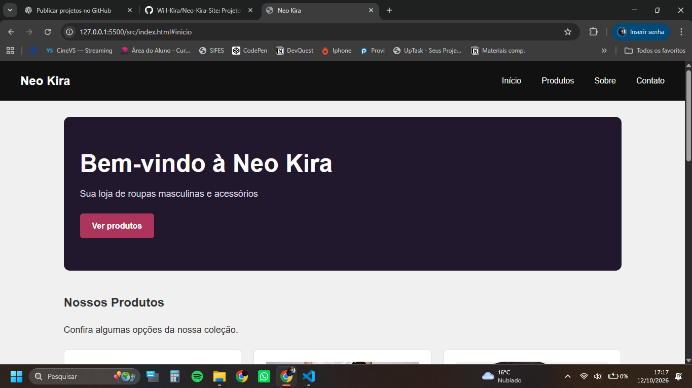
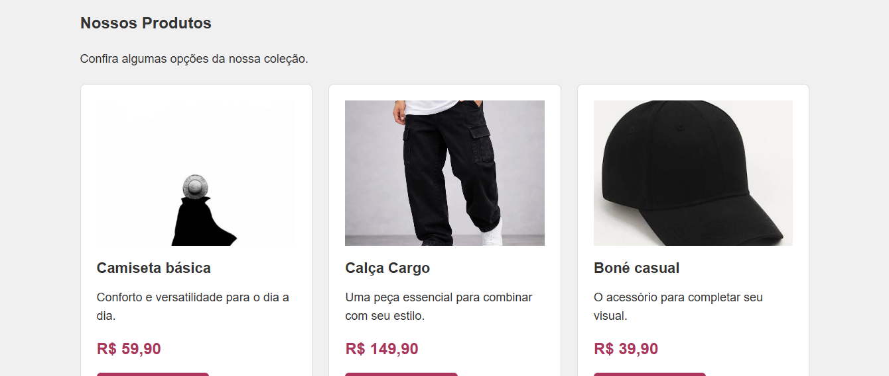
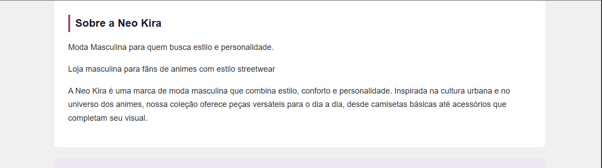
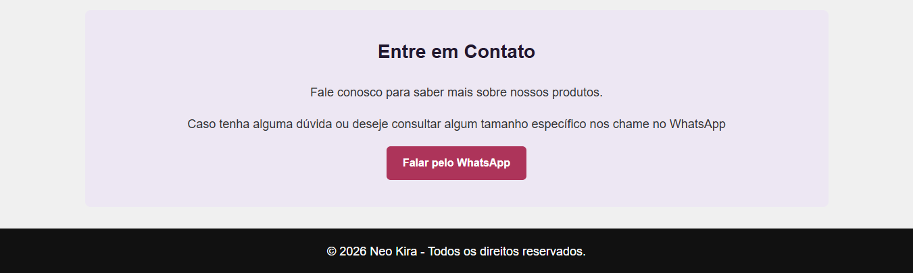

# 🛍️ Neo Kira — Loja de Moda Masculina

Projeto de uma página de loja virtual de roupas masculinas e acessórios, com inspiração na cultura anime e no estilo streetwear.

## 🚀 Tecnologias utilizadas

- HTML5
- CSS3
- JavaScript

## ✨ Funcionalidades

- Layout responsivo para desktop e dispositivos móveis
- Menu de navegação entre seções
- Vitrine de produtos com imagens, descrições e preços
- Efeito hover nos cards dos produtos
- Botões de contato via WhatsApp
- Atualização automática do ano no rodapé

## 📚 Aprendizados

Durante o desenvolvimento, pratiquei:

- HTML semântico
- Seletores e propriedades CSS
- Flexbox e CSS Grid
- Media Queries
- Efeitos hover e transições
- Manipulação básica do DOM com JavaScript
- Versionamento com Git e GitHub

## 👨‍💻 Sobre o projeto

Este projeto foi desenvolvido para praticar conhecimentos de desenvolvimento Front-end e compor meu portfólio profissional.

## 📸 Prévia do Projeto

### Captura 1

### Captura 2

### Captura 3

### Captura 4
